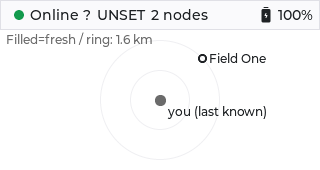
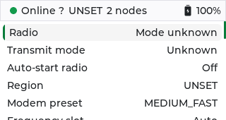

<p align="center">
  
</p>

<h1 align="center">M5Stack Cardputer Zero Mesh App</h1>

<p align="center">
  <b>A Meshtastic&reg; client for the M5Stack CardputerZero</b><br>
  A native LVGL messaging app + a Python radio supervisor, built to be robust enough to trust.
</p>

<p align="center">
  
</p>

<p align="center">
  
  
  
  
  
</p>

---

## What this is

The **M5Stack CardputerZero** is a credit-card-sized Debian Linux computer (Raspberry Pi CM0) with its own
keyboard, screen, battery and a **LoRa SX1262 "Cap"** radio. This project turns it into a real
**[Meshtastic](https://meshtastic.org) handheld** — send and receive text on public or private channels, see who's
out there, and share a channel by QR — with an interface designed for the tiny 320&times;170 screen and the
46-key keyboard.

The current source is **0.1.9, a release candidate** with public/private channel
support and fixes from an independent security and robustness review. Native UI,
sanitizer, backend and Debian arm64 package checks pass. Private-peer delivery,
camera QR and physical cold-power checks passed. Outdoor GPS, live public-mesh
delivery and other remaining device checks are documented in the
[verification record](docs/review-remediation.md); the candidate is not a claim
that all hardware qualification is complete.

> **Meshtastic&reg; is a registered trademark of Meshtastic LLC.** This is an independent, community project and
> is not affiliated with or endorsed by Meshtastic LLC or M5Stack.

## Screenshots

These are native LVGL renders using synthetic data, not personal messages or device identities.

| Messages | Nodes | Map | Settings |
|:--:|:--:|:--:|:--:|
|  |  |  |  |

## User guide & quick reference

**[Read the illustrated user guide](docs/user-guide/README.md)** or go straight to
the **[Quick Reference Card](docs/user-guide/00-Quick-Reference-Card.md)**.
The guide covers first setup, keyboard controls, messages, nodes, the map,
settings and troubleshooting. [Versioned PDF downloads](docs/user-guide/README.md#offline-downloads)
are available for offline use and printing.

## Features

- **Compact keyboard UI** — fixed conversation/channel header, complete footer help and grouped Settings with Radio first.

- **Public and private channels** — clearly labeled group conversations and explicit DM channel selection; no silent channel fallback.

- **Threaded messaging** — a conversation per channel and per node, with mesh versus recipient acknowledgments, unconfirmed sends and failure reasons and **resend** for the ones the mesh drops.
- **First-run setup** — select a region and public/private primary channel; initialize receive-only, then explicitly enable TX with antenna confirmation. Requires the qualified meshtasticd 2.7.26 build and client 2.7.11.
- **Durable chats** — bounded private SQLite history, identity-bound drafts, pinned chats, case-sensitive conversation search (`/`), and local-time quiet hours. Saved history can be disabled and erased.
- **Channel manager and mesh profiles** — create/rename/rotate/enable/disable/remove channels with actual readback; preview and apply named local profiles while Off. Profile application leaves TX, location and MQTT Off.
- **Diagnostics** — current connection, firewall, versions and GPS age; optional sanitized export excludes keys, chats, IDs and coordinates.
- **Quick messages** — one-key canned replies ("OK", "On my way", "Need help"&hellip;), editable in Settings.
- **Nodes & Map** — who's on the mesh, signal, battery, last-heard, distance; a you-centred radar map.
- **Mesh-native tools** — share your **location**, request a node's position, **trace the route** a packet
  takes, and **share a channel as a QR code** (only the selected channel, public or private).
- **Per-thread controls** — mute, mark-read, clear history, delete a conversation; an unread badge and a
  notification toast when a message arrives while you're elsewhere.
- **Settings that persist** — region, modem preset, frequency slot, hop limit, add-a-channel (QR or paste), node name,
  delivery-ack and retention preferences, theme — all saved across restarts.
- **Keyboard-first** — the bare **F / X / Z / C** keys are the d-pad everywhere except while typing; hold
  **Fn** for arrows inside a text box. Press **HELP** on any screen for its keys.

## Build your own

Want to build an app for this device? This repo is the worked example for a full guide:
**[Building Apps for the M5Stack Cardputer Zero](https://github.com/Prophet60191/m5stack-cardputer-zero-app-guide)**
— the platform, the UI+supervisor architecture, the keyboard, packaging, and publishing.

## Architecture

Two cooperating processes with a clean boundary — the UI never touches the radio:

```
  ┌────────────────────┐   newline-JSON    ┌──────────────────────┐   TCP (loopback)   ┌────────────┐
  │  C++ / LVGL app     │  intents  ───────▶│  Python supervisor   │ ─────────────────▶ │ meshtasticd │──▶ LoRa Cap
  │  (what you see)     │◀─────────  events │  (owns the radio)    │   meshtastic lib   │  (daemon)   │    (SX1262)
  └────────────────────┘   Unix socket     └──────────────────────┘                    └────────────┘
```

- The **app** (MIT) renders screens and sends **intents** (`radio.start`, `message.send`, `traceroute`&hellip;)
  over a local Unix socket; it holds no radio state of its own.
- The **supervisor** (GPL-3.0, because it uses the GPL `meshtastic` library) powers the Cap, runs `meshtasticd`
  through a guardian, with TCP **firewall-confined to loopback**, and translates intents into radio actions. The full contract is in
  [docs/supervisor-protocol.md](docs/supervisor-protocol.md).

## Hardware you need

- An **M5Stack CardputerZero** running its Debian image.
- The **Cap LoRa-1262** (SX1262 + antenna). **Attach the antenna before powering the radio** — transmitting
  without it can permanently damage the chip.
- A Meshtastic mesh to talk to (another node, e.g. a T-Deck), on a region you're licensed for.

## Install & run

> This repo ships the **app** and the **supervisor**. The radio stack it depends on — `meshtasticd` and the
> `meshtastic` Python library — are **GPL-3.0** and are **not** bundled here; you install them yourself (below).

**1. Install the built Debian package on the device:**

```bash
# Prevent the dependency package from starting its separate system daemon.
sudo systemctl mask --now meshtasticd.service
sudo apt install ./cardputerzero-mesh_0.1.9-rev1_arm64.deb
# The qualified Debian build used for this candidate:
sudo apt install 'meshtasticd=2.7.26.61~obs54e0d8d~beta'
```

The package installs the supervisor and a boot-persistent capability firewall
service, with no app sudo grant. On launch, a fixed helper creates a transient
service in the logged-in user’s systemd manager. No shared user-unit file is
installed and package installation does not start RF.
Keep the existing platform SPI/GPIO/I2C/video/input permissions;
do not run the app as root or grant blanket sudo.
If that exact daemon build is unavailable from the configured repositories, obtain
the corresponding verified upstream package rather than substituting a newer
firmware/client combination. Runtime compatibility checks fail closed before
power-on; this installer does not add repositories or install the radio stack.

**2. Install the pinned radio client in your own venv:**

```bash
python3 -m venv "${XDG_DATA_HOME:-$HOME/.local/share}/cardputerzero-mesh/venv"
"${XDG_DATA_HOME:-$HOME/.local/share}/cardputerzero-mesh/venv/bin/pip" install 'meshtastic==2.7.11'
```

Camera QR scanning is optional. The built-in CSI camera uses the fixed
`rpicam-still`/libcamera capture program; it does not open the raw CSI video node
as a webcam. On Debian 13, install `python3-pil` and `libzbar0t64` from Debian,
and install `pyzbar==0.1.9` in the radio venv:

```bash
sudo apt install python3-pil libzbar0t64
"${XDG_DATA_HOME:-$HOME/.local/share}/cardputerzero-mesh/venv/bin/pip" install 'pyzbar==0.1.9'
```

Create/update the venv with `python3 -m venv --system-site-packages <venv-path>`
so it can import the system Pillow package. `python3-opencv` is needed only for a
USB/V4L2 webcam fallback. Pasting a private share URL works without a camera.

**3. Attach the antenna and launch Mesh from the grid.** On an empty state directory, first-run setup creates a receive-only profile. Choose your permitted region and public or newly generated private primary channel. Existing profiles are preserved. Use Settings → Transmit mode to enable TX deliberately. A private group needs its selected-channel QR shared with the intended peer.

The launcher starts the
transient user supervisor service; radio startup stays an explicit action unless you enable
auto-start. Closing the UI leaves the supervisor running; stop the radio or the
user service before swapping the Cap. The firewall must pass verification before power-on. Check setup with:

```bash
python3 /usr/lib/cardputerzero-mesh/firewall.py health
systemctl is-enabled cardputerzero-mesh-firewall.service
systemctl --user status cardputerzero-mesh-supervisor.service
```

For an upgrade, stop the radio/supervisor as the logged-in user before replacing
its files, then launch Mesh again. The fixed lifecycle helper can also restart it
explicitly (this stops any running radio and its child processes):

```bash
python3 /usr/lib/cardputerzero-mesh/user_service.py stop
# Install the reviewed update, then launch Mesh, or:
python3 /usr/lib/cardputerzero-mesh/user_service.py ensure
# Explicit restart when needed:
python3 /usr/lib/cardputerzero-mesh/user_service.py restart
```

Closing Mesh keeps the background supervisor available for reception. The service
is created on demand after login; it is not enabled for boot. A cold boot starts
without RF until Mesh is opened and its normal explicit/approved auto-start
setting is applied. Before uninstall, stop the supervisor with the helper above.

Source development can run the supervisor manually with the pinned venv, after
installing this package's runtime/firewall integration. The retired `radio_up.py`
entry point cannot bypass those checks.

Public and private channels are both supported, including imports, messaging,
DMs, position requests, traces and selected-channel QR sharing. New message and
Channels show **Public/Private** labels. Choose a DM's channel explicitly; no
missing/disabled channel falls back to primary. The label describes the channel
key, not a guarantee of the firmware's per-message DM encryption.

Imported channels start with location and MQTT forwarding off, and do not retune
the radio from the share URL. All channels share one region, modem preset and
frequency slot. Match those to the mesh you want to join; Settings includes
**Frequency slot** (0 = Auto, derived from the primary channel's name).

Public messages and firmware identity/telemetry can be visible to others.
Automatic public location starts off, requires a separate confirmation and is
limited to 15-bit precision (roughly 730 m). A manual public location send can
contain precise coordinates and has its own confirmation. Only the selected
channel is enabled for automatic location; Off disables it on every channel.
Unapproved public location defaults are disabled on disk **before** firmware can
broadcast. A matching, confirmed public-location choice survives restarts.

Use the appropriate regional band and a valid preconfigured profile. Persisted
configuration must use the qualified firmware's preference schema 24;
incomplete/other versions fail closed. See [the security model](docs/security.md).

## Build

A desktop **simulator** (SDL) gives fast, flash-free UI iteration; the device build targets the CardputerZero's
framebuffer. Build presets and requirements (desktop, device and Debian package) is in
[docs/build.md](docs/build.md).

```bash
# desktop simulator (macOS example)
cmake --preset darwin-arm64 && cmake --build build/darwin-arm64 --config Release
./build/darwin-arm64/Release/cardputerzero-mesh

# device (native, on the CardputerZero)
cmake --preset cp0-native -DCM0_SDK_ROOT=/ -DCM0_ALLOW_FETCH_DEPS=ON
cmake --build build/cp0-native --config Release
```

## Security

This release candidate includes fixes from an independent code and sensitivity review;
see the remediation record for verification limits.
Highlights of what's hardened:

- The `meshtasticd` TCP API is **confined to loopback** (it binds all interfaces by default).
- Sends require the **selected, enabled channel**, public or private; a missing
  channel never falls back to primary. Public location requires deliberate opt-in.
- Privacy settings show Pending/Unknown until effective radio settings are confirmed.
- The control socket is owner-only (`0600`, ownership-checked); the UI verifies the supervisor is yours.
- Input and work are bounded (frames, JSON, queued bytes, connections, operations, traces) and the supervisor survives hostile/stuck clients.

See [docs/security.md](docs/security.md) for the full list. Found something? Please open an issue.

## License

- **App** (`src/`, this README, the CMake build) — **MIT**, &copy; 2026 Jose Di Lenola. Originally based on the
  MIT-licensed M5Stack CardputerZero Application Template; that attribution is preserved in [NOTICE](NOTICE).
- **Supervisor** (`supervisor/supervisor.py`) — **GPL-3.0-or-later**, because it links the GPL `meshtastic`
  library. See [supervisor/LICENSE.GPL](supervisor/LICENSE.GPL).
- Bundled fonts/assets keep their own licenses (see [NOTICE](NOTICE)); `meshtasticd` and the `meshtastic`
  library are separate GPL-3.0 projects you install yourself.

See [LICENSE](LICENSE) and [NOTICE](NOTICE).

---

<p align="center"><sub>Built for the M5Stack CardputerZero • <a href="https://github.com/Prophet60191">github.com/Prophet60191</a></sub></p>

## Radio resource conflicts

If startup reports that the NFC SPI-CS2 overlay reserves GPIO22, close the NFC
app and cold-restart the device before using LoRa. The official NFC app uses
GPIO22 as SPI-CS2 and documents that its runtime overlay stays until reboot;
LoRa uses that pin as BUSY. Mesh checks ownership before power-on and does not
unbind another app's kernel driver. See the [upstream NFC hardware notes](https://github.com/CardputerZero/Cap-CC1101-NFC#hardware).
