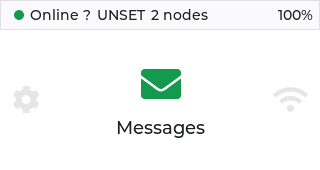
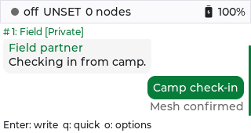
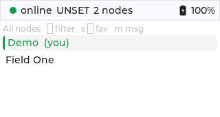

<p align="center">
  
</p>

<h1 align="center">M5Stack Cardputer Zero Mesh App</h1>

<p align="center">
  <b>The first Meshtastic&reg; client for the M5Stack CardputerZero</b><br>
  A native LVGL messaging app + a Python radio supervisor, built to be robust enough to trust.
</p>

<p align="center">
  
</p>

<p align="center">
  
  
  
  
  
</p>

---

## What this is

The **M5Stack CardputerZero** is a credit-card-sized Debian Linux computer (Raspberry Pi CM0) with its own
keyboard, screen, battery and a **LoRa SX1262 "Cap"** radio. This project turns it into a real
**[Meshtastic](https://meshtastic.org) handheld** — send and receive encrypted text over the mesh, see who's
out there, and share a channel by QR — with an interface designed for the tiny 320&times;170 screen and the
46-key keyboard.

As far as we can tell, **it's the first Meshtastic client for this device.** The on-device app Store ships no
Meshtastic client; the one mesh app it does have speaks a different protocol (MeshCore); and the only earlier
Meshtastic attempt couldn't bring up this board's radio at all. So this is new ground — and because a mesh
radio you carry deserves it, the whole thing was put through an independent security and privacy review
before release (see [Security](#security)).

> **Meshtastic&reg; is a registered trademark of Meshtastic LLC.** This is an independent, community project and
> is not affiliated with or endorsed by Meshtastic LLC or M5Stack.

## Screenshots

| Messages | Nodes | Map | Settings |
|:--:|:--:|:--:|:--:|
|  |  |  |  |

## Features

- **Threaded messaging** — a conversation per channel and per node, with delivery status (sending / delivered
  with hop count / failed) and **resend** for the ones the mesh drops.
- **Quick messages** — one-key canned replies ("OK", "On my way", "Need help"&hellip;), editable in Settings.
- **Nodes & Map** — who's on the mesh, signal, battery, last-heard, distance; a you-centred radar map.
- **Mesh-native tools** — share your **location**, request a node's position, **trace the route** a packet
  takes, and **share a channel as a QR code** (the private channel only — never your public default).
- **Per-thread controls** — mute, mark-read, clear history, delete a conversation; an unread badge and a
  notification toast when a message arrives while you're elsewhere.
- **Settings that persist** — region, modem preset, hop limit, add-a-channel (QR or paste), node name,
  delivery-ack and retention preferences, theme — all saved across restarts.
- **Keyboard-first** — the bare **F / X / Z / C** keys are the d-pad everywhere except while typing; hold
  **Fn** for arrows inside a text box. Press **HELP** on any screen for its keys.

## Build your own

Want to build an app for this device? This repo is the worked example for a full guide:
**[Building Apps for the M5Stack Cardputer Zero](https://github.com/Prophet60191/m5stack-cardputer-zero-app-guide)**
— the platform, the UI+supervisor architecture, the keyboard, packaging, and publishing.

## Architecture

Two cooperating processes with a clean boundary — the UI never touches the radio:

```
  ┌────────────────────┐   newline-JSON    ┌──────────────────────┐   TCP (loopback)   ┌────────────┐
  │  C++ / LVGL app     │  intents  ───────▶│  Python supervisor   │ ─────────────────▶ │ meshtasticd │──▶ LoRa Cap
  │  (what you see)     │◀─────────  events │  (owns the radio)    │   meshtastic lib   │  (daemon)   │    (SX1262)
  └────────────────────┘   Unix socket     └──────────────────────┘                    └────────────┘
```

- The **app** (MIT) renders screens and sends **intents** (`radio.start`, `message.send`, `traceroute`&hellip;)
  over a local Unix socket; it holds no radio state of its own.
- The **supervisor** (GPL-3.0, because it uses the GPL `meshtastic` library) powers the Cap, runs `meshtasticd`
  as a child bound to **loopback only**, and translates intents into radio actions. The full contract is in
  [docs/supervisor-protocol.md](docs/supervisor-protocol.md).

## Hardware you need

- An **M5Stack CardputerZero** running its Debian image.
- The **Cap LoRa-1262** (SX1262 + antenna). **Attach the antenna before powering the radio** — transmitting
  without it can permanently damage the chip.
- A Meshtastic mesh to talk to (another node, e.g. a T-Deck), on a region you're licensed for.

## Install & run

> This repo ships the **app** and the **supervisor**. The radio stack it depends on — `meshtasticd` and the
> `meshtastic` Python library — are **GPL-3.0** and are **not** bundled here; you install them yourself (below).

**1. Radio dependencies (on the device):**

```bash
# meshtasticd (the LoRa daemon) — see https://meshtastic.org/docs/software/linux/
sudo apt install meshtasticd            # or the official .deb for your image

# the meshtastic client library, in a venv the supervisor uses
python3 -m venv .venv
.venv/bin/pip install meshtastic
```

**2. Confine the radio API to loopback (one-time, needs root):**

```bash
sudo supervisor/firewall-setup.sh      # meshtasticd binds all interfaces; this restricts it to localhost
```

**3. Start the supervisor, then launch the app:**

```bash
.venv/bin/python supervisor/supervisor.py &               # owns the radio, serves the UI socket
./build/cp0-native/Release/template_app                   # the app (or launch it from the grid)
```

Antenna-before-power, private channel only, US band (902–928 MHz in the US) — the app and supervisor enforce
the channel rules; the antenna rule is on you.

## Build

A desktop **simulator** (SDL) gives fast, flash-free UI iteration; the device build targets the CardputerZero's
framebuffer. Full build matrix (Linux/macOS/Windows desktop, cross-compile, Debian package) is in
[docs/build.md](docs/build.md).

```bash
# desktop simulator (macOS example)
cmake --preset darwin-arm64 && cmake --build build/darwin-arm64 --config Release
./build/darwin-arm64/Release/template_app

# device (native, on the CardputerZero)
cmake --preset cp0-native -DCM0_SDK_ROOT=/ -DCM0_ALLOW_FETCH_DEPS=ON
cmake --build build/cp0-native --config Release
```

## Security

Because this is a radio you carry, it went through an independent code + sensitivity review before release.
Highlights of what's hardened:

- The `meshtasticd` TCP API is **confined to loopback** (it binds all interfaces by default).
- Sends **refuse an unconfigured channel** — a "private" conversation can never fall through to the public
  default channel.
- "Share position: Off" **actually stops** location broadcasts (not just the interval).
- The control socket is owner-only (`0600`, ownership-checked); the UI verifies the supervisor is yours.
- Input is bounded (line length, JSON nesting, connections) and the supervisor survives hostile/stuck clients.

See [docs/security.md](docs/security.md) for the full list. Found something? Please open an issue.

## License

- **App** (`src/`, this README, the CMake build) — **MIT**, &copy; 2026 Jose Di Lenola. Originally based on the
  MIT-licensed M5Stack CardputerZero Application Template; that attribution is preserved in [NOTICE](NOTICE).
- **Supervisor** (`supervisor/supervisor.py`) — **GPL-3.0-or-later**, because it links the GPL `meshtastic`
  library. See [supervisor/LICENSE.GPL](supervisor/LICENSE.GPL).
- Bundled fonts/assets keep their own licenses (see [NOTICE](NOTICE)); `meshtasticd` and the `meshtastic`
  library are separate GPL-3.0 projects you install yourself.

See [LICENSE](LICENSE) and [NOTICE](NOTICE).

---

<p align="center"><sub>Built for the M5Stack CardputerZero • <a href="https://github.com/Prophet60191">github.com/Prophet60191</a></sub></p>
