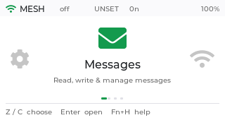

# Shared Cardputer Zero home menu

Mesh uses the guide's shared NFC Tools home layout. This is a 320×170
shell: 23-pixel header, app icon and name on the left, right-aligned plain
battery percentage (omitted when unavailable), centered 40-pixel current
icon, 28-pixel dimmed neighboring icons, title and subtitle, one position
dot per card, and a keyboard-hint footer. The shared implementation is
vendored unchanged as `src/view/widgets/home_menu.h`.

Mesh fills the spare header lane with its existing radio mode, region, node
count, and unread indicator. These can't overlap the battery lane. The
feature screens retain their original title bars and the home app keeps its
own palette, labels, actions, and keyboard routes. This layout change does not
start the radio, modify saved state, or change the supervisor or packaging.

The [dark-theme capture](screenshots/carousel-dark.png) and this light-theme
capture come from synthetic 320×170 simulator runs. The simulator's 100%
value is not a device measurement. See the
[Cardputer Zero App Guide](https://prophet60191.github.io/m5stack-cardputer-zero-app-guide/)
for the reusable layout. Device installation and physical checks are separate
from this source and simulator update.
