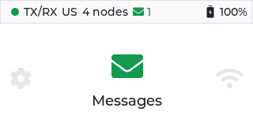
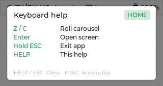
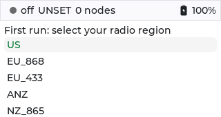
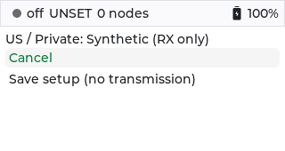

# Introduction & Getting Started

> For Mesh **0.1.15 (release candidate)** · Updated **2026-11-22** · [Guide index](README.md)

Welcome to the **Cardputer Zero Mesh App**! This app turns your M5Stack CardputerZero and its LoRa radio Cap into a pocket-sized, off-grid communicator using the **Meshtastic** mesh network.

With it, you can send messages, share your location, and see nearby radios—all directly over radio waves, with **no cell service, Wi-Fi, or internet needed**.

---

## How the Mesh Works (Three Things to Know)

If this is your first time using Meshtastic, three simple ideas will make every screen feel natural:

- **Nodes & Hops:** Each radio on the network is called a **node**—yours and everyone else's. Nearby radios can automatically pass messages along (**hops**) so your text can reach people beyond direct range, as long as everyone shares the same **region** and radio tuning.
- **Public vs. Private Channels:** **Public** channels work like open community rooms where anyone nearby on that channel can read messages and see your radio's name and status. **Private** channels use a secret key so only people you share the channel with can read your conversation.
- **Safe first setup:** A new setup starts with the radio **off**, **Receive-Only (`RX`)** selected, and automatic location and MQTT sharing off. Existing setups keep their settings; an already-running background radio stays on, and **Auto-start radio** can start it on launch. Once transmission is enabled, firmware can send identity, telemetry and relayed traffic as well as your messages.

---

Before following these guides, install the app and its radio dependencies using the [installation instructions](../../README.md#install--run).

**Privacy:** Keep a private channel's QR code or share URL secret: it contains the group key. Public traffic can be read by others, and another mesh node may forward it to the Internet even when your own MQTT setting is Off. Saved chats are not encrypted on the device. The Private label describes a channel key; it does not certify the firmware's separate DM encryption.

## Before You Start: Hardware Care

Keep these three rules in mind whenever you handle the CardputerZero and LoRa Cap:

1. **Always attach the LoRa antenna before turning on the radio.**
   Turning on or transmitting without an antenna attached can permanently damage the radio inside the Cap.
2. **Turn the radio off before removing or swapping the Cap.**
   Always switch **Radio** to **off** in Settings before unplugging hardware.
3. **Restart the CardputerZero after using the NFC app.**
   The NFC app holds onto shared hardware pins until the device restarts. If you used the NFC app earlier, power the CardputerZero completely off and back on before starting the LoRa radio.

---

## Tour of the Screen

Every screen shares a slim **Top Status Bar** at the top, with the active screen underneath.

### Top Status Bar

From left to right, the bar at the top tells you what the radio is doing at a glance:

- **Radio Dot & Mode:**
  - **Grey (`off`):** The radio is powered down.
  - **Yellow (`starting`):** The radio is warming up and checking its settings.
  - **Green (`RX` — Listen only):** The radio is on in **Receive-Only** mode—you can listen and see nodes, without sending anything over the air.
  - **Green (`TX/RX` — Send & receive):** The radio is on and ready to both **send and receive**.
  - **Green (`Online ?`):** The service reports Online, but the receive/transmit mode is unconfirmed. Check Diagnostics before sending.
  - **Red (`error`):** The radio stopped because something went wrong (a banner or Settings will explain why).
  - **Grey (`unknown`):** Shown briefly if the app is still connecting to the background radio service.
- **Region:** Your active radio region (such as `US` or `EU_868`, or `UNSET` before your first setup).
- **Node Count:** How many radios your device has heard (for example, `4 nodes`).
- **Unread Badge (`✉`):** Appears in green with a number whenever you have unread messages.
- **Battery (top-right):** Shows your battery icon and charge percentage.

### Home Carousel (Main Menu)

When the app opens, you land on the **Home Carousel**—the central hub with four screens:

- **Messages** — Read and send group chats and direct messages.
- **Nodes** — Browse nearby radios, check signal strength, and view node details.
- **Map** — View a compass-style radar of nodes that shared their location.
- **Settings** — Turn the radio on or off, set up channels and profiles, and manage privacy.

Press **ESC** to return toward the Home Carousel. In Messages, the first press clears an active search; press it again to return Home.

### Bottom Hint Line & Pop-Up Banners

- **Action footer:** Useful screen actions stay visible while you scroll. In the channel form, **1: Save channel** (or **Save profile**) applies your choices. Press **HELP** for routine navigation keys.
- **Pop-Up Banners:** Temporary banners slide in to keep you informed—such as showing a new incoming message while you are viewing the Map or Nodes screen, confirming a saved screenshot, reminding you about privacy when a Public channel is active, or flagging a radio notice.

---

## Using the CardputerZero Keyboard

The CardputerZero keyboard has no separate arrow cluster, so the app adjusts automatically depending on whether you are **browsing** or **typing**.

### When Browsing (Menus, Lists, Details, and Settings)

You do **not** need to hold `Fn` to move around:

- **F / X** — Move **Up / Down** through lists, options, and settings, or scroll long info cards.
- **Z / C** — Roll **Left / Right** on the Home Carousel.
- **Enter** — Open the highlighted menu, pick an item, or confirm a choice.
- **ESC** — Close a pop-up or go back one screen.

*(Holding **Fn + F / X / Z / C** also works as arrow keys anytime.)*

### When Typing in a Text Box

As soon as a typing bar or text prompt opens, **F, X, Z, C** return to typing normal letters:

- **Fn + F / X / Z / C** — Move the cursor up, down, left, or right inside the text box.
- **Shift** — Type capital letters and upper punctuation marks.
- **Sym** — Type the blue symbols printed on the keys (`? ! @ # $ % & * ( ) - / : '`).
- **Backspace** — Erase the character before the cursor.
- **Enter** — Send your message or save what you typed.
- **ESC** — Stop typing and close the box *(if you were writing a message, your unfinished text is saved as a draft)*.

### Anytime Shortcuts

| Key | What It Does |
|---|---|
| **HELP** | Opens a **Keyboard help** cheat sheet for the screen you are on. Press **HELP** or **ESC** to close it. |
| **PRSC** | Saves a PNG screenshot to your `Pictures/Screenshots` folder and shows the file location in a banner. |
| **Hold ESC** *(Home Carousel only)* | Exits the app cleanly once the **"Hold ESC to exit"** banner completes. |

---

## Opening, Closing, and Background Listening

It helps to know how the app screen and the radio work together during the day:

- **Opening the app** connects to the background radio service. If the radio is already running, it stays running. Otherwise it stays **off** until you turn it on in **Settings**, unless **Auto-start radio** is enabled.
- **Closing the app** (by holding **ESC** on the Home Carousel) closes the screen, **but leaves the radio running in the background** if it was already on. That way, your device keeps listening and catches incoming messages even while the app isn't open.
- **To save battery or shut down completely**, open **Settings** and turn **Radio** **Off** before closing the app.

---

## Example: Your First Time Using the App

With your LoRa antenna attached, follow these steps the very first time you launch the app:

1. **Pick Your Region:**
   Because the radio isn't set up yet, the app opens **Settings** automatically and asks: **First run: select your radio region**. Use **F** / **X** to highlight your region (for example, `US` or `EU_868`) and press **Enter**.

   

2. **Choose Your Starting Channel:**
   - Choose **Private: generate a new secret** to start with a private group, type a short name (up to 11 UTF-8 bytes (11 plain English characters), like `Field` or `Trail`), and press **Enter**.
   - Or choose **Public default** to listen and talk on the open public Meshtastic channel.
3. **Save Safely Without Transmitting:**
   Highlight **Save setup (no transmission)** and press **Enter**. Your starting setup is saved in **Receive-Only** mode.

   

4. **Turn On the Radio:**
   Highlight **Radio** (the first row in **Settings**) and press **Enter**. In a few seconds, the top-left dot turns from yellow (`starting`) to green (**`RX`**)—you are now listening to nearby mesh traffic.
5. **Enable Sending When Ready:**
   Double-check that your antenna is secure, highlight **Transmit mode** in **Settings**, press **Enter**, and pick **Enable transmission**. The top-left bar changes to **`TX/RX`**. Press **ESC** to return to the Home Carousel and open **Messages** to start chatting.

---

## Explore the Other Guides

- [Quick Reference Card](00-Quick-Reference-Card.md) — One-page field cheat sheet.
- [Messages Menu Guide](02-Messages-Menu.md) — Group chats, direct messages, quick replies, delivery checks, location sharing, route tracing, and QR sharing.
- [Nodes Menu Guide](03-Nodes-Menu.md) — Reading the radio directory, signal bars, filtering, favourites, and distances.
- [Map Menu Guide](04-Map-Menu.md) — Using the compass radar, distance rings, and reading fresh vs. older positions.
- [Settings Menu Guide](05-Settings-Menu.md) — Radio controls, channels, mesh profiles, GPS, privacy, notifications, and diagnostics.
- [Troubleshooting & FAQ](06-Troubleshooting-and-FAQ.md) — Solutions for common messages, radio errors, and range/sync questions.

---

[Quick Reference](00-Quick-Reference-Card.md) | [Next: Messages Menu →](02-Messages-Menu.md)
