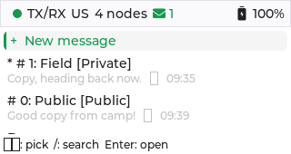
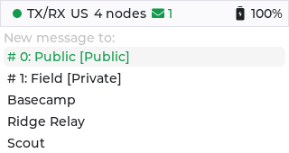
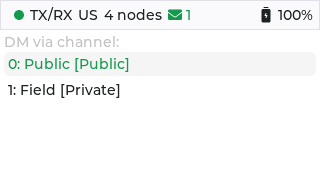
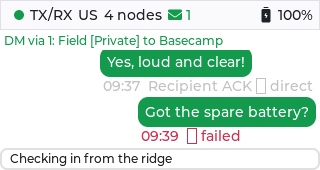
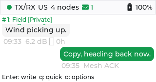
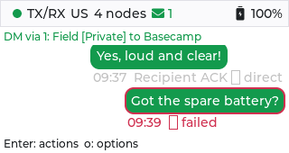
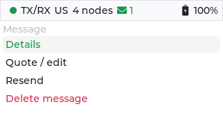
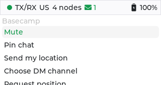
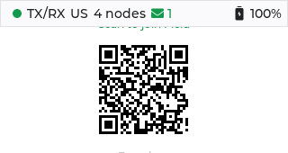

# Messages Menu

> For Mesh **0.1.7 (release candidate)** · Updated **2026-11-16** · [Guide index](README.md)

The **Messages** screen is where you start conversations, read incoming texts, send replies, and use mesh tools like location sharing and route tracing.

From the Home Carousel, roll to **Messages** with **Z** / **C** and press **Enter** to open it.

---

## Keyboard Shortcuts in Messages

| Where You Are | Key | What It Does |
|---|---|---|
| **Conversations List** | **F / X** | Move up and down the list |
| | **Enter** | Open **`+ New message`** or the highlighted conversation |
| | **/** | Filter conversations by keyword (case-sensitive) |
| | **ESC** | Clear an active search filter, or return to the Home Carousel |
| **Inside a Chat** | **Enter** | Open the typing box *(or open options when a message bubble is highlighted)* |
| | **q** | Send a **Quick message** |
| | **o** | Open **Thread options** |
| | **F** | Step up through individual message bubbles |
| | **X** | Step back down toward the newest message and return to compose mode |
| | **ESC** | Unselect a bubble, cancel typing, or return to the Conversations List |
| **Anytime** | **HELP** | Show Messages shortcuts |

*(See [Introduction & Getting Started](01-Introduction-and-Getting-Started.md) for general typing tips like `Fn`, `Shift`, and `Sym`.)*

---

## Before You Send: Radio Must Be in `TX/RX`

You can read existing messages and browse chats anytime, even while the radio is off. However, to **send** a message, share your location, request a position, or trace a route, the radio must be turned **On** and set to **Transmit mode** (**`TX/RX`** in the top-left bar; see [Settings](05-Settings-Menu.md)).

- If you try to send while the radio is off or in Receive-Only (`RX`) mode, the message bubble appears marked **`✗ failed`** (open its **Details** to see why). Once **`TX/RX`** is enabled, you can highlight that bubble and choose **Resend**.

---

## The Conversations List

When you open **Messages**, you see your chats ordered so important and recent ones stay easy to reach:



1. **`+ New message`** is always at the top.
2. **Pinned chats** come next, marked with a `*` before the name.
3. **All other chats** follow from most recent to oldest.

### Reading Conversation Titles & Previews

- **Group Channels** start with `#` and clearly show whether the channel is open or private (for example, `# 0: Public [Public]` or `# 1: Field [Private]`).
  - **Archived Channels:** If a channel is later renamed, has its private key rotated, or is disabled/removed, past messages remain readable under **`Archived: ...`** so your history never mixes with a different group.
- **Direct Messages (DMs)** show the other person's radio name (like `Basecamp`), or their node ID (like `!10000002`) if their name hasn't arrived yet.
- **Preview Line:** Shows the newest message and time (`HH:MM`). If you left an unfinished message, it shows **`Draft: ...`** instead.

### Incoming Message Alerts

- If a new message arrives while you are on **Home**, **Nodes**, **Map**, or **Settings**, a **3-second pop-up banner** shows who sent it and a preview, and the green unread badge (`✉`) updates at the top (unless that chat is muted, **Mute all** is On, or **Quiet hours** is active).
- If you are already on **Messages**, the list or open chat simply updates in place without popping up a banner over your typing.

---

## Searching Conversations (`/`)

If your list gets long, press **`/`** on the Conversations List to filter it:

1. Press **`/`**, type a word or name, and press **Enter**.
   - Search is **case-sensitive** (`Basecamp` and `basecamp` are treated differently).
   - It matches any conversation whose title, draft, or saved messages contain that text.
2. Press **ESC** on the filtered list to clear the search and see all chats again.

---

## Starting a Chat (`+ New message`)

1. Highlight **`+ New message`** and press **Enter**.
2. Pick from your **group channels** (`# ...` at the top) or any **other radio** listed below them, and press **Enter**.



### Why Direct Messages Ask You to Choose a Channel

When you start or open a **Direct Message** (including by pressing **`m`** from the [Nodes](03-Nodes-Menu.md) screen), the app asks you to pick a channel:



Even direct messages travel across one of your radio channels. The app never guesses or falls back to another channel on its own: you choose the route explicitly. **Private/Public labels describe the channel key, not a guarantee of the firmware's per-message DM encryption.**

- Look at the green header bar inside any open DM to verify which channel is active (for example: `DM via 1: Field [Private] to Basecamp`).
- To switch channels while inside a DM, press **`o`** and choose **Choose DM channel**.

---

## Writing, Drafts, and Quick Messages

### Typing & Automatic Drafts

1. Inside a chat, press **Enter** to open the typing bar at the bottom. The prompt reminds you whether you are sending on a `[Private channel]` or `[Public channel]`.



2. Type up to **200 UTF-8 bytes** (200 plain English characters; accented letters and emoji can use several bytes each) and press **Enter** to send.
3. If you press **ESC** or leave before sending, your unfinished text is automatically saved as a **Draft** tied to that specific chat and channel.
   - *Tip:* For Direct Messages, each draft stays linked to the channel you were typing on. If you later open that DM on a different channel while empty, the screen reminds you: `Saved draft (edit on its original channel)`.
   - If a group channel was archived/removed, you can still read old messages there, but sending is blocked so you don't send on the wrong channel.

### Quick Messages (`q`)

For one-handed replies on the move, press **`q`** inside any chat thread, highlight a ready-made phrase with **F** / **X** (such as `OK`, `On my way`, `Copy that`, `Need help`, `Stand by`, or `What's your position?`), and press **Enter**—it sends right away.

*(You can customize this list anytime in [Settings → Quick messages](05-Settings-Menu.md#messages).)*

---

## Reading Bubbles & Delivery Status



- **Received messages** sit on the left. Group chats display the sender's name above the message. If **Signal on messages** is turned on in Settings, signal quality and hops appear underneath (for example, `6.2 dB · 0h`).
- **Your messages** sit on the right in green, with a delivery status underneath:

| Status Label | What It Means |
|---|---|
| `sending…` | Queued or sending; waiting for a delivery confirmation (up to 60 seconds). This is not proof that it has been received. |
| `Mesh ACK` | Another radio on the mesh heard and acknowledged your packet. |
| `Recipient ACK · direct` *(or `· 2h`)* | For Direct Messages: the specific person's radio confirmed delivery, plus how many hops it took. |
| `Sent (unconfirmed)` | Sent with **Message acks** turned off in Settings—no acknowledgment was requested. |
| `✗ failed` | Timed out after 60 seconds without confirmation, the radio stopped/restarted, or sending was rejected. |

**No Automatic Replays:** If a message fails—including if you turn off the radio or restart the device while a message says `sending…`—it stays marked **`✗ failed`** and is **never** automatically sent later behind your back.

---

An acknowledgment comes from a **radio**, not a person: it does not mean someone has read your message. A timeout also does not prove that nobody received it; a retry may repeat a message at the other end.

## Acting on a Single Message

You can inspect, quote, retry, or delete any message bubble:

1. Inside a chat, press **F** (Up) to highlight the bottom message bubble with a **red outline**, then use **F** / **X** to move between bubbles.



2. Press **Enter** on a highlighted bubble to open its menu:



   - **Details:** Shows sender/recipient, exact timestamp (`HH:MM:SS`), channel, delivery status, signal (`SNR`), hops, relay info, and—for failed messages—the **Reason** (such as *"No route to destination"* or *"No acknowledgment before timeout"*).
   - **Quote / edit:** Copies that bubble's text into your typing bar so you can edit or reply with it.
   - **Resend:** *(Shown on your own `✗ failed` messages)* Retries sending that exact message—provided its original channel is still active.
   - **Delete message:** Immediately removes that single message from your device *(shown in red; no extra confirmation screen)*.
3. Press **ESC** (or scroll past the newest bubble with **X**) to return to normal compose mode.

---

## Thread Options (`o`)

While inside any conversation, press **`o`** to open its options menu:



- **Mark as read:** Appears if the chat still has unread messages *(opening a chat also marks it read automatically)*.
- **Mute / Unmute:** Silences pop-up notifications and unread badge counts for this conversation only.
- **Pin chat / Unpin chat:** Pins the conversation near the top of your Conversations List with a `*`.
- **Send my location:** Sends a one-time text message containing your current GPS coordinates (e.g., `📍 40.00000, -105.00000`).
  - Requires a fresh GPS fix (within 2 minutes). If your GPS doesn't have a fresh lock yet, a banner warns `"no position fix yet"` or `"GPS fix is stale or its age is unknown; wait for a fresh fix before sending"`.
  - If the active channel is **`[Public]`**, a confirmation screen (**Send precise coordinates**) protects you from broadcasting exact coordinates by accident.
- **Share channel (QR)** *(Group chats only)*: Displays a scannable QR code for **just that single channel** so a friend can join it. Press **ESC** to close it. *(If the channel changes while the QR code is open, it closes automatically so nobody scans an outdated code.)*
- **Choose DM channel** *(Direct Messages only)*: Pick or switch which channel your DMs to this person use.
- **Request position** *(Direct Messages only)*: Asks the other person's radio to send back its position, which updates their entry on [Nodes](03-Nodes-Menu.md) and [Map](04-Map-Menu.md).
- **Trace route** *(Direct Messages only)*: Sends a route test (up to ~20 seconds; up to 2 traces can run at a time) and lists the relay path between `You` and that radio (`You ↓ Ridge Relay ↓ Basecamp`). Press **ESC** anytime if you want to cancel waiting.
- **Clear history:** Immediately deletes all messages inside this conversation while keeping the thread, draft, pin, and mute status *(shown in red)*.
- **Delete conversation:** Immediately erases all messages, drafts, pin, and mute settings for this thread and returns to the Conversations List *(shown in red)*.
- **Conversation info:** Shows a read-only summary card (who sees a group channel, or a DM peer's node ID, latest signal, and hops).

---

## Step-by-Step Examples

### Example 1: Sending a Direct Message and Tracing the Route

1. Make sure your radio shows **`TX/RX`** in the top-left bar.
2. Open **Messages**, highlight **`+ New message`**, and press **Enter**.
3. Highlight your friend's radio (for example, `Basecamp`) and press **Enter**.
4. In **DM via channel:**, highlight `1: Field [Private]` and press **Enter**.
5. Press **Enter** to type `"Checking in from the ridge"`, then press **Enter** to send.
6. Watch the label under your green bubble change from `sending…` to `Recipient ACK · 1h` (delivered via 1 relay hop).
7. To see which relay carried your message, press **`o`**, select **Trace route**, and wait a few seconds for the hop list:
   ```text
   You
     ↓
   Ridge Relay
     ↓
   Basecamp
   ```

### Example 2: Resending a Failed Message

1. You spot **`✗ failed`** under a message you sent while out of range (or while in `RX` mode).
2. Once you have signal (and **`TX/RX`** is enabled), open the chat and press **F** to highlight that bubble with the red outline.
3. Press **Enter**, check **Details** if you want to see why it failed, or choose **Resend** and press **Enter**.
4. The bubble switches back to `sending…` and updates once acknowledged.

### Example 3: Sharing a Private Group Channel by QR Code

1. Open your private group chat (for example, `# 1: Field [Private]`).
2. Press **`o`**, highlight **Share channel (QR)**, and press **Enter**.
3. Hold the QR code steady while your friend scans it using **Settings → Add a channel → Scan QR code** (or the Meshtastic phone app).



4. Press **ESC** when finished. Treat a private channel QR like a password; anyone who scans it gets that group key. The pictured QR is synthetic demonstration data, not a channel to join.

---

[← Introduction](01-Introduction-and-Getting-Started.md) | [Quick Reference](00-Quick-Reference-Card.md) | [Next: Nodes Menu →](03-Nodes-Menu.md)
