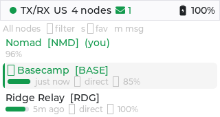
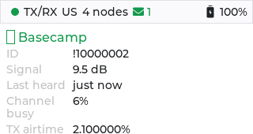

# Nodes Menu

> For Mesh **0.1.12 (release candidate)** · Updated **2026-11-17** · [Guide index](README.md)

The **Nodes** screen is your live directory of every Meshtastic radio your device has heard on the mesh (up to 256 nodes), with your own radio always anchored at the top as **`(you)`**.

From the Home Carousel, roll to **Nodes** with **Z** / **C** and press **Enter** to open it.

---

## Keyboard Shortcuts in Nodes

| Key | Action |
|---|---|
| **F / X** | Move up and down the list *(or scroll inside an open Details card)* |
| **Enter** | Open **Details** for the highlighted node |
| **s** | Star or unstar the highlighted node as a **Favourite** (`★`) |
| **m** | Jump straight to a **Direct Message** with the highlighted node |
| **Tab** | Cycle the list filter: **All nodes** → **Favorites** → **Active** |
| **ESC** | Close the Details card, or return to the Home Carousel |
| **HELP** | Show Nodes shortcuts |

---

## Reading the Nodes List

Nodes are sorted automatically so the radios you care about stay at the top:

1. **Your own radio `(you)`** is always first.
2. **Favourites (`★`)** come next.
3. **Everyone else** follows, ordered from most recently heard to oldest.

Each row gives you a quick summary:

- **Top Line:** Star icon (`★` if favourited), node name (or ID like `!10000004` if no name has been received yet), short callsign in brackets (like `[BASE]`), and `(you)` for your own device. Both `(you)` and your **Favourites** have their names highlighted in **green** so they stand out immediately.
- **Bottom Line:**
  - **Green Signal Bar:** Visual strength indicator for their last transmission (shown once a packet with signal data is received).
  - **Last Heard:** Relative time since their last transmission (`just now`, `5m ago`, `2h ago`, or `3d ago`). *(Your own row omits this.)*
  - **Hops:** Whether they reached you `direct` (0 hops) or through relays (`1 hops`, `2 hops`, etc.).
  - **Battery:** Their reported battery percentage (for example, `85%`).

The list refreshes when a nearby node sends a message, position, or status update. Age labels and the Active filter also advance while you leave the screen open. Incoming updates keep the same node selected; if it disappears, choose a node again before taking an action.

### Empty List Messages

- If the radio hasn't started yet and no nodes are stored, **All nodes** displays: `No nodes yet. Start the radio in Settings.`
- If you select **Favorites** or **Active** and nothing matches, you'll see: `No nodes match this filter.` *(Your own `(you)` entry remains visible in every filter when your radio is running.)*

---

## Filtering the List (`Tab`)

Press **Tab** to switch the filter shown in the top line of the screen:

1. **All nodes:** Every node your radio has heard.
2. **Favorites:** Only nodes you have starred (`★`), plus `(you)`.
3. **Active:** Only nodes heard within the last **1 hour**, plus `(you)`.

---

## Starring Favourites (`s`) & Quick Messaging (`m`)

- **Star a Favourite (`s`):** Highlight any other node—or open its **Details** card—and press **`s`**. A `★` appears next to its name and keeps it near the top of the list across restarts. *(You cannot star `(you)`.)*
- **Start a Direct Message (`m`):** Highlight any other node—or open its **Details** card—and press **`m`**. The app switches directly to [Messages](02-Messages-Menu.md) and opens a Direct Message with that person (prompting you to pick which channel to send on).

*Tip:* If incoming radio traffic updates and re-sorts the list while you have a node's **Details** card open, pressing **`s`** or **`m`** still targets the exact node you are looking at—never a neighbor that shifted underneath it.

---

## Viewing Full Node Details (`Enter`)

Highlight any node—including `(you)`—and press **Enter** to inspect everything your device knows about it. Use **F** / **X** to scroll if the card runs off the screen:

| Field | What It Shows |
|---|---|
| **ID** | Unique Meshtastic node address (e.g., `!10000002`). |
| **Signal** | Signal-to-noise ratio in decibels (`dB`), when available. Positive values (like `9.5 dB`) are clear; negative values mean weaker or distant reception. |
| **Last heard** | How long ago they were heard (`this device` for `(you)`). |
| **Channel busy** | Percentage of radio channel utilization around that node, if reported. |
| **TX airtime** | Percentage of airtime that node spends transmitting, if reported. |
| **Route** | `direct`, `1 hops`, `2 hops`, or `unknown`. |
| **Battery** | Charge percentage and voltage (for example, `85% (3.95 V)`), or `-` if not reported. |
| **Position** | Last known GPS latitude and longitude (or `-`). |
| **Fix age** | How old that GPS fix is in seconds; marked **`(stale)`** when older than 2 minutes. |
| **Satellites** | Number of GPS satellites seen (or `Unknown`). |
| **Distance** | Straight-line distance from **you** to that node (`450 m` or `2.4 km`), shown automatically whenever both radios have a position. |
| **Favourite** | `yes` or `no` (`-` on `(you)`). |

Press **ESC** to close the Details card and return to the Nodes list.

---

## Step-by-Step Examples

### Example 1: Finding Out How Far Away a Friend Is

1. Open **Nodes** from the Home Carousel.
2. Highlight your friend's node (for example, `Ridge Relay [RDG]`) with **F** / **X** and press **Enter**.
3. Scroll down with **X** to check **Position**, **Fix age**, and **Distance** (for example, `1.8 km`).
4. If **Position** shows `-` or **Fix age** is stale, press **`m`** right from the Details card to open a DM, then use **`o` → Request position** in [Messages](02-Messages-Menu.md) to ask for an updated fix.

### Example 2: Bookmarking Your Group Before Heading Out

1. On **Nodes**, highlight each teammate's radio one by one and press **`s`** to mark them with `★`.
2. When a busy public mesh fills the list with unfamiliar nodes, press **Tab** once to switch to **Favorites** so you see only `(you)` and your starred teammates.

---

[← Messages Menu](02-Messages-Menu.md) | [Quick Reference](00-Quick-Reference-Card.md) | [Next: Map Menu →](04-Map-Menu.md)
