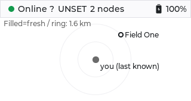

# Map Menu

> For Mesh **0.1.12 (release candidate)** · Updated **2026-11-17** · [Guide index](README.md)

The **Map** screen is an offline, north-up radar centered on **you**, showing the direction and relative distance of every node that has shared a GPS position.

From the Home Carousel, roll to **Map** with **Z** / **C** and press **Enter** to open it.

---

## Keyboard Shortcuts on Map

The Map is a glance-and-go live display—dots cannot be selected individually here. Use [Nodes](03-Nodes-Menu.md) whenever you want to inspect a specific radio's coordinates, signal, or battery.

| Key | Action |
|---|---|
| **ESC** | Return to the Home Carousel |
| **HELP** | Show Map shortcuts |
| **PRSC** | Save a PNG screenshot of the radar map |

---

## How to Read the Radar Map

Because the CardputerZero works completely off-grid without internet map tiles, the Map plots everyone cleanly on two concentric rings and updates automatically whenever new locations arrive. Freshness colors also age while the screen stays open, without waiting for another packet:

### 1. You Are Always at the Center

- The dot at the center is your device, labeled **`you`** (when your GPS fix is under 2 minutes old) or **`you (last known)`** (when your fix is older than 2 minutes).

### 2. Directions Match a Compass

- **Up** (top of the screen) = **North**
- **Right** = **East**
- **Down** (bottom of the screen) = **South**
- **Left** = **West**

The map stays north-up; it does not rotate with the direction you are holding the device.

### 3. Auto-Scaling Distance Rings

- Two rings surround you: an **outer ring** and a **halfway inner ring**.
- The outer ring automatically adjusts so the **farthest positioned node** sits right on the outer ring (or defaults to `1.0 km` if no other nodes are farther away).
- Read the top-left label to check the outer ring's scale—for example:
  - **`Last known / ring: 2.1 km`** means the outer ring is 2.1 km from you, and the inner ring is roughly 1.05 km from you.
  - **`Last known / ring: 450 m`** means all positioned nodes are within 450 meters.

### 4. Node Labels & Freshness Colors

Each positioned peer appears as a dot labeled with its short callsign (such as `BASE`, `RDG`, or `SCT`, or its full name if no short name is set). Radios without a GPS fix (`Position: -` in [Nodes](03-Nodes-Menu.md)) are simply omitted from the radar map:

- **Bright Green Dot:** Fresh GPS fix updated within the **last 2 minutes**.
- **Dimmed Grey Dot:** Older ("last known") position from **more than 2 minutes ago**, or one whose timestamp is missing, unknown or in the future.

*Privacy Note:* This app limits its own automatic public position sharing to roughly 730-meter precision. **Other radios choose their own precision**, and a public position can be precise. The map displays the received coordinates; it does not blur them or guarantee a privacy radius.

---

## Common On-Screen Messages

- **`"No position fix yet. Go outside with a sky view and give the GPS a minute."`**
  Your device doesn't have a GPS lock yet. Check that **GPS receiver** is enabled in [Settings → Location & Internet](05-Settings-Menu.md#location--internet), then step outdoors with an open sky view for a minute.
- **`"No other nodes have shared a position."`**
  Your device knows where *you* are (`you` appears at the center with a default `1.0 km` outer ring), but no other nodes have sent coordinates yet. Many radios keep location sharing off by default—see [Messages → Thread Options](02-Messages-Menu.md#thread-options-o) if you want to ask a friend directly using **Request position**.

---

## Step-by-Step Example: Spotting Which Way Camp Is

1. Take your CardputerZero outside and open **Map** from the Home Carousel.
2. Once your GPS locks on, your center dot displays **`you`**.
3. You see a bright green dot labeled **`BASE`** toward the **top-right**, a green dot **`RDG`** toward the **bottom-left**, and a grey dot **`SCT`** on the lower-right edge (`Last known / ring: 2.1 km`).
4. That tells you **Basecamp** (`BASE`) and **Ridge Relay** (`RDG`) updated within the last 2 minutes, while **Scout** (`SCT`) is roughly 2.1 km to your southeast using an older last-known fix.
5. To view exact numbers like `Distance` or `Fix age`, press **ESC**, open [Nodes](03-Nodes-Menu.md), highlight a radio, and press **Enter**.

---

[← Nodes Menu](03-Nodes-Menu.md) | [Quick Reference](00-Quick-Reference-Card.md) | [Next: Settings Menu →](05-Settings-Menu.md)
