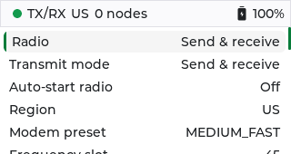
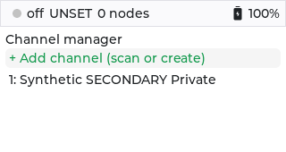
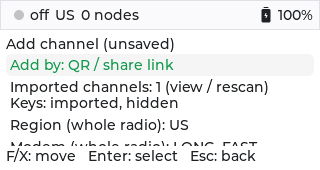
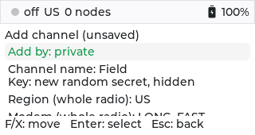
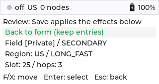
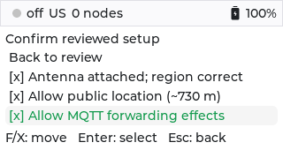
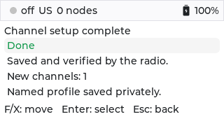
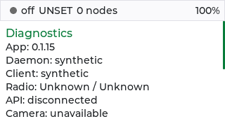

# Settings Menu

> For Mesh **0.1.13 (release candidate)** · Updated **2026-11-17** · [Guide index](README.md)

The **Settings** screen is where you turn the radio on and off, set your region and channels, manage privacy and notifications, save mesh profiles, and check system health.

From the Home Carousel, roll to **Settings** with **Z** / **C** and press **Enter** to open it.

---

## Keyboard Shortcuts in Settings

| Key | Action |
|---|---|
| **F / X** | Move up and down Settings, scroll info cards, or highlight options |
| **Enter** | Open a setting, toggle an option, or save what you typed |
| **ESC** | Cancel an open pop-up/editor, or return to the Home Carousel |
| **HELP** | Show Settings shortcuts |

---

## Before Changing a Setting: Radio On vs. Off

The app keeps radio hardware and saved setups cleanly separated, so some settings expect the radio to be **On** while a couple require it to be **Off**:

- **Needs Radio ON:** `Region`, `Modem preset`, `Frequency slot`, `Hop limit`, `Channel manager`, `Node name`, `GPS receiver`, `Share position`, and `Internet (MQTT)`.
- **Needs Radio OFF:** Applying a saved **Mesh profile**, or running the **First-run setup** wizard when no profile exists yet.
- **Works Anytime (On or Off):** `Radio`, `Transmit mode`, saving or deleting a **Mesh profile**, `Channels`, `First-run setup` status check, `Diagnostics`, `About`, and all **Messages**, **Notifications**, and **Theme** preferences.

### How Confirmation Works (`Pending...` and `Unknown`)

Radio hardware changes are read back before confirmation. Local app preferences (such as theme and quiet hours) are saved separately:

- **`Unknown`:** Shown for radio settings while the radio is turned off or disconnected.
- **`Pending...`:** Shown briefly while the radio applies and verifies a change.
- **Automatic Restart:** Changing **Region**, **Modem preset**, **Frequency slot**, or **GPS receiver** automatically saves your change, restarts the radio safely, and verifies that the new value stuck.
- **Privacy Fail-Safe:** If the radio ever fails to confirm a change to **Transmit mode**, **Share position**, or **Internet (MQTT)**, the app automatically stops the radio rather than leave you guessing about privacy or transmitting.

---

## Radio & Tuning (Top of Settings)

| Setting | What It Does & How to Use It |
|---|---|
| **Radio** | Always the first row. Shows live status (`off off`, `online receive-only`, `online transmit`, or `error`). Press **Enter** to start or stop the radio. *(Attach your antenna first!)* |
| **Transmit mode** | Switch between **`Receive only`** (listen quietly) and **`Enable transmission`**. Enabling transmission asks you to confirm that your antenna is attached and your region is set. |
| **Auto-start radio** | Toggle **On / Off**. When **On**, starts the radio automatically once per app launch. |
| **Region** | Choose your legal LoRa band (`US`, `EU_868`, `EU_433`, `ANZ`, `NZ_865`, `KR`, `TW`, `JP`, `SG_923`, `TH`, `MY_919`, `PH_915`). Everyone in your group must use the same region. |
| **Modem preset** | Balances range vs. speed (`LONG_FAST`, `LONG_MODERATE`, `LONG_SLOW`, `MEDIUM_FAST`, `MEDIUM_SLOW`, `SHORT_FAST`, `SHORT_SLOW`). `LONG_FAST` is the common Meshtastic default; everyone on your mesh must match. |
| **Frequency slot** | Enter **`0`** (`Auto`, calculated from your primary channel name) or **`1`–`255`**. Use a slot supported by your selected region and match your group's effective frequency; firmware determines which slots are valid. |
| **Hop limit** | Choose **`1`–`7`**. Sets how many relay hops your messages can travel (`3` is a good everyday default). |

---

## Channels & Node

### Mesh Profiles

Save up to **16** named snapshots of your region, tuning, and channels on the device so you can switch between setups cleanly:

1. Open **Mesh profiles** and choose **`+ Save current as profile`**, then enter a name (up to 48 UTF-8 bytes). *(Works with the radio On or Off.)*
2. To switch profiles, first make sure **Radio** is **Off**. Open **Mesh profiles** and pick a saved profile to preview its region, preset, frequency slot, and channels:
   - **Apply: radio Off, TX/location/MQTT Off:** Switches to that setup safely in receive-only mode with location sharing and MQTT turned off until you enable them.
   - **Delete saved profile:** Permanently deletes that saved profile from your device *(works anytime)*.

### Channel Manager

Open **Channel manager → `+ Add channel (scan or create)`** to use the same
complete setup form as **Settings → Add a channel**. Existing slot edits still
require Radio On; preparing and saving a new setup also works while Radio is Off.

Select an existing slot to **Rename**, **Rotate private key**, **Disable**,
**Remove** or **Enable** it. Primary slot `0` cannot be disabled or removed.
Renaming the primary with Auto frequency first requires an explicit frequency
slot. Removing a secondary frees its slot; disabling retains its saved key.
Old chats stay associated with their original channel identity.

### Add a Channel

Everything needed to add a channel is collected in one flow. Nothing is written
while you edit fields, scan, paste or review.

1. Choose **Scan QR code**, **Paste share URL**, **Create private channel**, or
   **Create public channel**. The private option generates a new random secret;
   it does not join someone else's private group. Join an existing group by QR
   or share URL. Keys remain hidden; pasted URLs are masked while typing.
2. For scanning, aim the camera and select **Start scan (Return)**. Repeated
   Return while busy does not start another scan. Esc cancels the scan and
   returns to the form.

3. Check the imported names and Public/Private classifications, or edit the new
   channel name (private names require 1–11 UTF-8 bytes). Imports keep existing
   tuning by default. **Use radio settings from QR / link** appears when a
   supported suggestion is available; selecting it changes the local form only.

4. Review **Region**, **Modem**, **Frequency slot**, **Hop limit**, **Transmit mode**,
   **Automatic location** and **Internet forwarding** in the same form. Radio
   tuning and transmit mode affect the whole radio. Channels cannot listen on
   different modem presets/frequencies simultaneously. Auto frequency uses the
   unchanged primary channel name; use a matching explicit slot when the sender
   has a different primary. An existing fixed frequency is displayed and can be
   preserved or explicitly cleared to use slots. Calibration stays unchanged.
5. New-channel location and forwarding start Off. Existing channels' sharing
   stays unchanged unless you choose automatic location for the new channel;
   that moves automatic sharing exclusively to it. The GPS receiver is unchanged.
   Enabling MQTT can also activate other already-forwarding channels and uses
   the configured broker; it does not configure broker credentials.
6. Choose **Current setup** or **Separate profile; keep active setup**. An optional
   **Profile name** saves a named snapshot alongside an applied setup. A separate
   profile requires a name, leaves the active radio/setup untouched, and starts
   receive-only with location/MQTT Off. It can be applied later from Mesh profiles.

7. Select **Review setup**, read the complete summary and warnings, then select
   **Save reviewed setup** (or **Save separate profile**). The first/default item
   returns to the form and preserves entries.

8. Confirm any required antenna/region, public location and MQTT acknowledgments,
   then select **Confirm save**. Saving tuning confirms its effect on every
   channel. A running radio restarts once; pending message ACKs are interrupted
   without automatic resend. Esc during Save asks you to wait for confirmation.

9. **Saved and verified by the radio** means actual readback passed. If Radio was
   Off, **Saved on device; live check when Radio is On** distinguishes stored
   confirmation from radio readback. **Open conversation** can take you directly
   to a new channel when it is live. An optional profile-save failure is reported
   separately; it does not imply the channel failed or invite a duplicate import.

Esc from an editor returns to the form; Esc from the form offers **Keep editing**
first or **Discard and close**. Discard before Save changes nothing. Validation
errors retain the form. If configuration changes elsewhere, reload the current
radio settings and review again. A failed active save stops the radio and tries
to restore the previous settings; failed recovery or an uncertain result is
reported explicitly. Inspect Channels/Diagnostics before retrying an uncertain save.

### Channels (Quick View)

Opens a read-only list of your active channels showing each slot number, name, `[Private]` or `[Public]` label, role (`PRIMARY` / `SECONDARY`), and `Location On` / `Location Off`.

### Node Name

Set the display name other radios see for you. Your 4-character short name is automatically set from the first 4 characters of your name.

---

## Location & Internet

| Setting | What It Does |
|---|---|
| **GPS receiver** | Choose **`Enable GPS receiver`** or **`Disable GPS receiver`**. Turning the GPS receiver on lets *you* see your own position on the Map and measure distance to nodes—it does **not** transmit your location to anyone else. |
| **Share position** | Controls **automatic** periodic position broadcasts (smart updates, up to every 15 minutes). Choose **Off** to turn automatic sharing off on every channel, or pick **one specific channel** to share on. • If you pick a **`[Public]`** channel, you must confirm **`Public location (~730 m)?`**, and your automatic position precision is limited to roughly 730 meters. This is approximate precision, not anonymity or protection from other ways of locating a radio. If sharing is already On, press **Enter** to switch it Off; open it again to choose another channel. |
| **Internet (MQTT)** | Toggle **On / Off**. Controls this radio's MQTT module. New setups default to **Off**; other radios may still forward received traffic to the Internet. |

---

## Messages

| Setting | What It Does |
|---|---|
| **Quick messages** | Manage the canned replies shown when you press `q` in [Messages](02-Messages-Menu.md). Choose **`+ Add new`** to add one, or highlight an existing phrase to edit it. To **delete** a phrase, open it, erase all the text so it is empty, and press **Enter**. |
| **Message acks** | Toggle **On / Off**. When **On**, sent messages request delivery confirmation (`Mesh ACK` / `Recipient ACK`). |
| **Signal on messages** | Toggle **On / Off**. Shows or hides signal (`dB`) and hop count under incoming chat bubbles. |
| **Save conversations** | Controls whether chat history, drafts, and pinned chat records are saved across restarts. Saved history is kept in a private folder on the device's storage (**not encrypted**). If you prefer not to keep chats on disk if the device is lost, choose **`Erase saved history; RAM only`** to remove stored messages and conversation records so your current session stays in memory only. Re-enabling it saves your current session and drafts back to storage. This is not a forensic secure erase of flash storage or a deletion of screenshots, backups, or copies on other radios. |
| **Keep per chat** | Limit saved messages per conversation: **`All`**, **`50`**, **`100`**, or **`200`** (subject to a 2,000-message total limit across all chats). |

---

## Notifications

| Setting | What It Does |
|---|---|
| **Mute all** | Toggle **On / Off**. Silences all incoming message banners and unread badge counts across the app. |
| **Quiet hours** | Automatically silences notifications during sleeping hours in your device's local time. Pick **`Off`**, **`22:00-07:00`**, or **`Custom times`** (enter any 24-hour range like `23:30-06:30`). |

---

## App & Setup

| Setting | What It Does |
|---|---|
| **Theme** | Switch between **Dark** mode (comfortable at night) and **Light** mode. |
| **First-run setup** | Safe to open anytime: if your radio is already set up, it opens a **Setup ready** card showing your active Region, Transmit mode, and Firewall status without changing anything. If no profile exists yet, it launches the first-time Region & Channel wizard. |
| **Diagnostics** | Choose **View current health** to inspect app/daemon/client versions, radio and API status, camera availability, GPS fix freshness/age/satellites, seconds since last received radio packet (`Last RX age`), message count, and firewall health. Choose **Export sanitized health** to save a private `diagnostics-export.json` report that strips out all messages, channel keys, node IDs, and GPS coordinates. |
| **About** | Shows app version, source URL, your Node ID, firmware version, hardware model, active region, and node name. |

---

## Step-by-Step Examples

### Example 1: Creating a Private Group Channel for a Family Trip

1. Open **Settings → Add a channel → Create private channel**.
2. Edit **Channel name** to `Trip2026`. Keep current radio tuning if your group
   already uses it; otherwise enter the group's matching settings in this form.
3. Leave location/forwarding Off, optionally name a mesh profile, and select
   **Review setup → Save reviewed setup → Confirm save**.
4. After live confirmation, choose **Open conversation**. Share the new group's
   QR from Messages (`o` → **Share channel (QR)**). If saved offline, turn Radio
   On with its antenna attached before messaging.

### Example 2: Scanning a Friend's Channel QR Code

1. Open **Add a channel → Scan QR code**, aim the camera, and select **Start scan**.
2. Review imported names/classification and matching radio settings in the form.
   Keep tuning or deliberately use supported QR suggestions; never assume that
   scanning alone proves you can reach the other radio.
3. Select **Review setup**, read the effects, and confirm Save.
4. After live readback, **Open conversation** opens the new chat directly.

### Example 3: Keeping a Separate Setup Without Retuning Now

1. In the Add channel form, select **Save to → Separate profile; keep active setup**.
2. Enter the desired channel/tuning and a profile name such as `Family Trip`.
3. Review and save the profile. The active setup/radio remains unchanged.
4. To use it later, turn Radio Off, select it in **Mesh profiles**, apply it, then
   turn Radio On. Transmission/location/MQTT remain Off until explicitly enabled.

---

[← Map Menu](04-Map-Menu.md) | [Quick Reference](00-Quick-Reference-Card.md) | [Next: Troubleshooting & FAQ →](06-Troubleshooting-and-FAQ.md)
