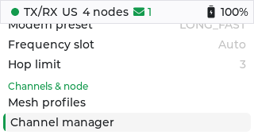
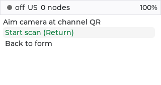
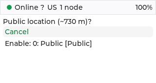
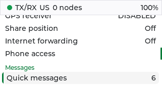

# Settings Menu

> For Mesh **0.1.11 (release candidate)** · Updated **2026-11-16** · [Guide index](README.md)

The **Settings** screen is where you turn the radio on and off, set your region and channels, manage privacy and notifications, save mesh profiles, and check system health.

From the Home Carousel, roll to **Settings** with **Z** / **C** and press **Enter** to open it.

---

## Keyboard Shortcuts in Settings

| Key | Action |
|---|---|
| **F / X** | Move up and down Settings, scroll info cards, or highlight options |
| **Enter** | Open a setting, toggle an option, or save what you typed |
| **ESC** | Cancel an open pop-up/editor, or return to the Home Carousel |
| **HELP** | Show Settings shortcuts |

---

## Before Changing a Setting: Radio On vs. Off

The app keeps radio hardware and saved setups cleanly separated, so some settings expect the radio to be **On** while a couple require it to be **Off**:

- **Needs Radio ON:** `Region`, `Modem preset`, `Frequency slot`, `Hop limit`, `Channel manager`, `Add a channel` (QR scan or URL), `Node name`, `GPS receiver`, `Share position`, and `Internet (MQTT)`.
- **Needs Radio OFF:** Applying a saved **Mesh profile**, or running the **First-run setup** wizard when no profile exists yet.
- **Works Anytime (On or Off):** `Radio`, `Transmit mode`, saving or deleting a **Mesh profile**, `Channels`, `First-run setup` status check, `Diagnostics`, `About`, and all **Messages**, **Notifications**, and **Theme** preferences.

### How Confirmation Works (`Pending...` and `Unknown`)

Radio hardware changes are read back before confirmation. Local app preferences (such as theme and quiet hours) are saved separately:

- **`Unknown`:** Shown for radio settings while the radio is turned off or disconnected.
- **`Pending...`:** Shown briefly while the radio applies and verifies a change.
- **Automatic Restart:** Changing **Region**, **Modem preset**, **Frequency slot**, or **GPS receiver** automatically saves your change, restarts the radio safely, and verifies that the new value stuck.
- **Privacy Fail-Safe:** If the radio ever fails to confirm a change to **Transmit mode**, **Share position**, or **Internet (MQTT)**, the app automatically stops the radio rather than leave you guessing about privacy or transmitting.

---

## Radio & Tuning (Top of Settings)

| Setting | What It Does & How to Use It |
|---|---|
| **Radio** | Always the first row. Shows live status (`off off`, `online receive-only`, `online transmit`, or `error`). Press **Enter** to start or stop the radio. *(Attach your antenna first!)* |
| **Transmit mode** | Switch between **`Receive only`** (listen quietly) and **`Enable transmission`**. Enabling transmission asks you to confirm that your antenna is attached and your region is set. |
| **Auto-start radio** | Toggle **On / Off**. When **On**, starts the radio automatically once per app launch. |
| **Region** | Choose your legal LoRa band (`US`, `EU_868`, `EU_433`, `ANZ`, `NZ_865`, `KR`, `TW`, `JP`, `SG_923`, `TH`, `MY_919`, `PH_915`). Everyone in your group must use the same region. |
| **Modem preset** | Balances range vs. speed (`LONG_FAST`, `LONG_MODERATE`, `LONG_SLOW`, `MEDIUM_FAST`, `MEDIUM_SLOW`, `SHORT_FAST`, `SHORT_SLOW`). `LONG_FAST` is the common Meshtastic default; everyone on your mesh must match. |
| **Frequency slot** | Enter **`0`** (`Auto`, calculated from your primary channel name) or **`1`–`255`**. Use a slot supported by your selected region and match your group's effective frequency; firmware determines which slots are valid. |
| **Hop limit** | Choose **`1`–`7`**. Sets how many relay hops your messages can travel (`3` is a good everyday default). |

---

## Channels & Node

### Mesh Profiles

Save up to **16** named snapshots of your region, tuning, and channels on the device so you can switch between setups cleanly:

1. Open **Mesh profiles** and choose **`+ Save current as profile`**, then enter a name (up to 48 UTF-8 bytes). *(Works with the radio On or Off.)*
2. To switch profiles, first make sure **Radio** is **Off**. Open **Mesh profiles** and pick a saved profile to preview its region, preset, frequency slot, and channels:
   - **Apply: radio Off, TX/location/MQTT Off:** Switches to that setup safely in receive-only mode with location sharing and MQTT turned off until you enable them.
   - **Delete saved profile:** Permanently deletes that saved profile from your device *(works anytime)*.

### Channel Manager

Inspect and edit all 8 channel slots (`0`–`7`) while the **Radio is On**:

- **`+ New private channel`:** Creates a secondary group with a freshly generated secret key (give it a name up to 11 UTF-8 bytes).
- **`+ New public channel`:** Creates a secondary channel using the standard public key.
- **Select an existing slot (`0`–`7`)** to manage it:
  - **Rename:** Change the channel name (up to 11 bytes). *Note:* Renaming slot `0` (your primary channel) requires setting an explicit non-zero **Frequency slot** first so renaming doesn't shift your radio frequency.
  - **Rotate private key:** Replaces that slot's key with a brand-new secret key (older radios won't read new messages until updated).
  - **Disable / Enable:** Temporarily pause or re-enable a slot without losing its saved name or secret key *(a Disabled slot still occupies that slot until you Remove it)*.
  - **Remove:** Completely erases a secondary slot (`1`–`7`) so it is free for new channels or QR imports. *(Primary slot `0` cannot be disabled or removed.)*

*Tip:* Creating or editing a channel always resets location sharing and MQTT forwarding to **Off** on that slot, and old chats remain separated under their original channel identity.

### Add a Channel

Join a channel shared by someone else while the **Radio is On** (new channels are placed into free secondary slots `1`–`7` and never overwrite your Primary slot `0`). Both **Scan QR code** and **Paste share URL** let you preview what will be added before saving anything:

- **Scan QR code:**
  1. Open **Add a channel → Scan QR code**.

     

  2. Aim the CardputerZero's camera at a Meshtastic channel QR code and press **Enter / Return** (`Scanning QR code...` runs for up to 12 seconds; press **ESC** anytime to cancel the scan cleanly).
- **Paste share URL:**
  Type or paste a `https://meshtastic.org/e/#...` channel link and press **Enter**.
- **Preview & Confirm:**
  1. If any new channels are found, a **Preview** screen lists each channel as `[Private]` or `[Public]` and marks whether it is `(new)` or `(existing)`, confirming that radio tuning stays unchanged and location/MQTT default **Off** (plus a visibility reminder if any new channel is `[Public]`). If a link contains multiple channels, use **F / X** to scroll through the list.

     

  2. Press **Enter / Return** to open the **`Add N channel(s)?`** prompt (**`Cancel`** is highlighted first by default so an accidental tap never imports anything). Press **X** (Down) to highlight **`Confirm import (location/MQTT Off)`** and press **Enter** within **2 minutes** *(or leave it on **Cancel** / press **ESC** to make no changes)*.
  3. While the radio writes and verifies the new slot(s), **`Importing channels...`** appears, followed by **`Import complete`** (`Imported N channel(s).`).
  4. If every channel in the QR code or link is already on your radio, the screen tells you **`Channels already present`** and makes no changes.

### Channels (Quick View)

Opens a read-only list of your active channels showing each slot number, name, `[Private]` or `[Public]` label, role (`PRIMARY` / `SECONDARY`), and `Location On` / `Location Off`.

### Node Name

Set the display name other radios see for you. Your 4-character short name is automatically set from the first 4 characters of your name.

---

## Location & Internet

| Setting | What It Does |
|---|---|
| **GPS receiver** | Choose **`Enable GPS receiver`** or **`Disable GPS receiver`**. Turning the GPS receiver on lets *you* see your own position on the Map and measure distance to nodes—it does **not** transmit your location to anyone else. |
| **Share position** | Controls **automatic** periodic position broadcasts (smart updates, up to every 15 minutes). Choose **Off** to turn automatic sharing off on every channel, or pick **one specific channel** to share on. • If you pick a **`[Public]`** channel, you must confirm **`Public location (~730 m)?`**, and your automatic position precision is limited to roughly 730 meters. This is approximate precision, not anonymity or protection from other ways of locating a radio. If sharing is already On, press **Enter** to switch it Off; open it again to choose another channel. |
| **Internet (MQTT)** | Toggle **On / Off**. Controls this radio's MQTT module. New setups default to **Off**; other radios may still forward received traffic to the Internet. |

---

## Messages

| Setting | What It Does |
|---|---|
| **Quick messages** | Manage the canned replies shown when you press `q` in [Messages](02-Messages-Menu.md). Choose **`+ Add new`** to add one, or highlight an existing phrase to edit it. To **delete** a phrase, open it, erase all the text so it is empty, and press **Enter**. |
| **Message acks** | Toggle **On / Off**. When **On**, sent messages request delivery confirmation (`Mesh ACK` / `Recipient ACK`). |
| **Signal on messages** | Toggle **On / Off**. Shows or hides signal (`dB`) and hop count under incoming chat bubbles. |
| **Save conversations** | Controls whether chat history, drafts, and pinned chat records are saved across restarts. Saved history is kept in a private folder on the device's storage (**not encrypted**). If you prefer not to keep chats on disk if the device is lost, choose **`Erase saved history; RAM only`** to remove stored messages and conversation records so your current session stays in memory only. Re-enabling it saves your current session and drafts back to storage. This is not a forensic secure erase of flash storage or a deletion of screenshots, backups, or copies on other radios. |
| **Keep per chat** | Limit saved messages per conversation: **`All`**, **`50`**, **`100`**, or **`200`** (subject to a 2,000-message total limit across all chats). |

---

## Notifications

| Setting | What It Does |
|---|---|
| **Mute all** | Toggle **On / Off**. Silences all incoming message banners and unread badge counts across the app. |
| **Quiet hours** | Automatically silences notifications during sleeping hours in your device's local time. Pick **`Off`**, **`22:00-07:00`**, or **`Custom times`** (enter any 24-hour range like `23:30-06:30`). |

---

## App & Setup

| Setting | What It Does |
|---|---|
| **Theme** | Switch between **Dark** mode (comfortable at night) and **Light** mode. |
| **First-run setup** | Safe to open anytime: if your radio is already set up, it opens a **Setup ready** card showing your active Region, Transmit mode, and Firewall status without changing anything. If no profile exists yet, it launches the first-time Region & Channel wizard. |
| **Diagnostics** | Choose **View current health** to inspect app/daemon/client versions, radio and API status, camera availability, GPS fix freshness/age/satellites, seconds since last received radio packet (`Last RX age`), message count, and firewall health. Choose **Export sanitized health** to save a private `diagnostics-export.json` report that strips out all messages, channel keys, node IDs, and GPS coordinates. |
| **About** | Shows app version, source URL, your Node ID, firmware version, hardware model, active region, and node name. |

---

## Step-by-Step Examples

### Example 1: Creating a Private Group Channel for a Family Trip

1. Turn **Radio** **On** in Settings (with your antenna attached).
2. Scroll to **Channel manager** and press **Enter**.
3. Highlight **`+ New private channel`** and press **Enter**.
4. Type a short name—for example, `Trip2026`—and press **Enter**.
5. Highlight **Create private** on the confirmation prompt (**Create new group? Location/MQTT Off.**) and press **Enter**.
6. Wait a moment for readback confirmation. Your new `[Private]` channel is ready in [Messages](02-Messages-Menu.md), where you can share it by QR code (`o` → **Share channel (QR)**).

### Example 2: Scanning a Friend's Channel QR Code

1. Make sure **Radio** is **On** in Settings.
2. Scroll to **Add a channel** and press **Enter**, then pick **Scan QR code**.
3. Aim the CardputerZero's camera at your friend's Meshtastic QR code and press **Enter / Return**.
4. Keep steady while **`Scanning QR code...`** runs.
5. Check the **Preview** screen to confirm the channel name and `[Private]` / `[Public]` label, press **Enter / Return**, and pick **Confirm import (location/MQTT Off)**.
6. When **`Import complete`** confirms the import, press **ESC** and open **Messages → `+ New message`** to find the new channel.

### Example 3: Switching Setups with Mesh Profiles

Suppose you keep one setup for local public chat and another for private family trips:

1. Configure your town channels and tuning, then open **Settings → Mesh profiles → `+ Save current as profile`** and name it `Town Public`.
2. Set up your private channels and tuning, then save a second profile named `Family Trip`.
3. Whenever you want to switch later:
   - Turn **Radio** **Off** at the top of Settings.
   - Open **Mesh profiles**, select `Family Trip`, review the preview, and pick **Apply: radio Off, TX/location/MQTT Off**.
   - Turn **Radio** back **On**, verify your antenna, and enable **Transmit mode** when ready to send.

---

[← Map Menu](04-Map-Menu.md) | [Quick Reference](00-Quick-Reference-Card.md) | [Next: Troubleshooting & FAQ →](06-Troubleshooting-and-FAQ.md)
